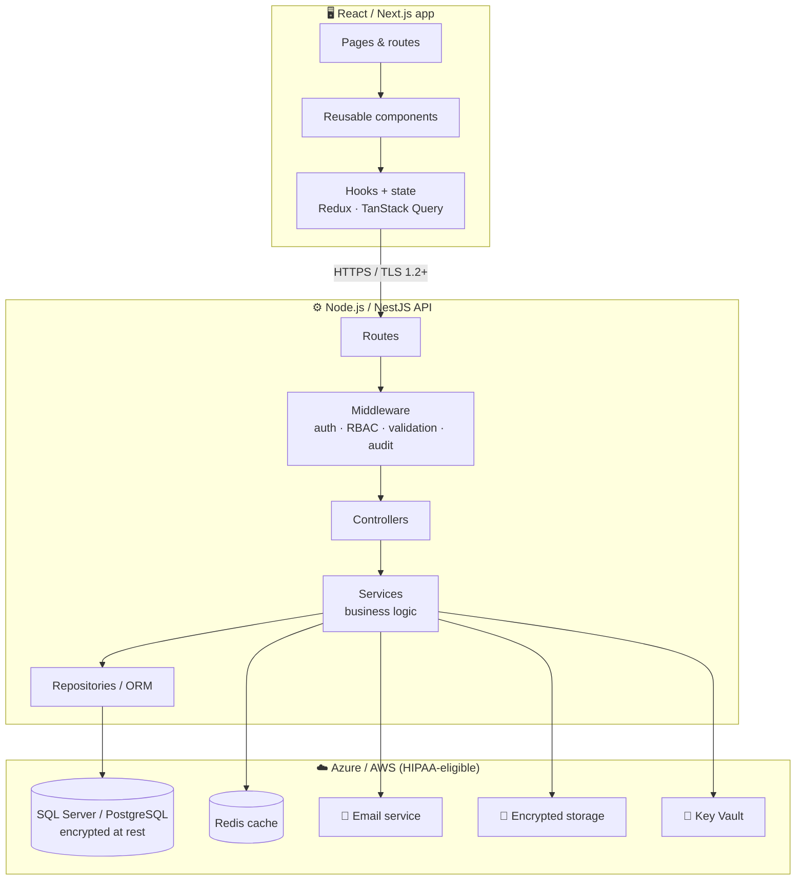
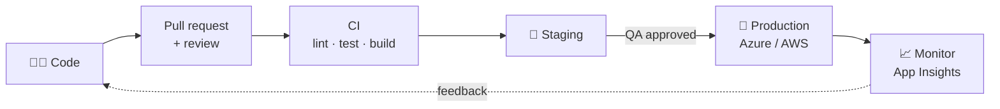
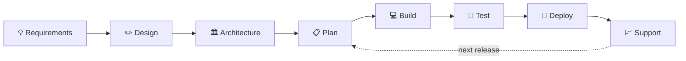
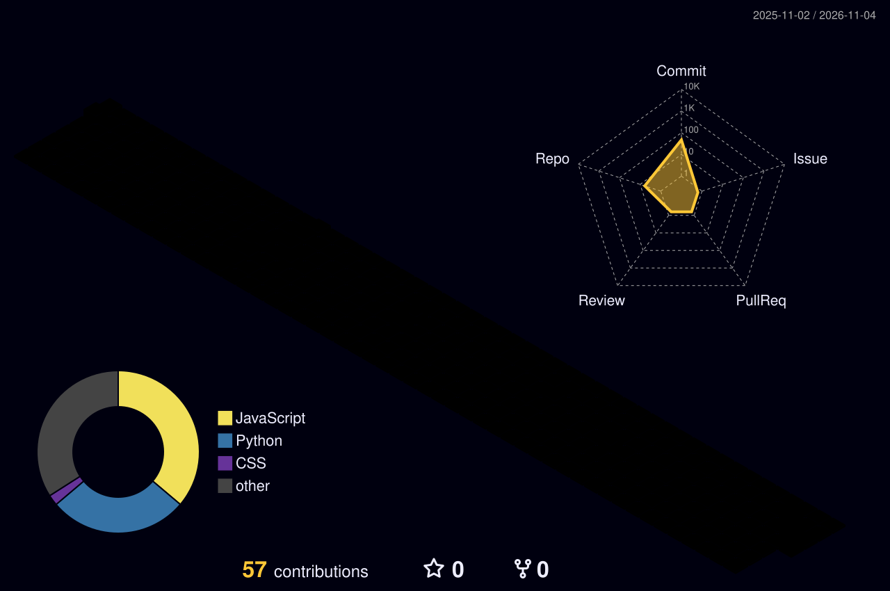

  
  
  
  

  
  

## 👋 About me

Hi, I'm **Shivanjali Desai**, a **senior React and full-stack developer** based in **Pune, India**, with **4+ years** of building business software, from an empty repo to a live, scaled product, and leading the teams that build it.

- ⚛️ **React first:** fast, polished, accessible UIs with **React**, **Next.js**, **TypeScript** and **Redux Toolkit**
- ⚙️ **Full-stack:** secure APIs and databases with **Node.js**, **NestJS**, **Express**, **Flask**, **SQL Server**, **PostgreSQL** and **MongoDB**
- 🏥 **Domain depth:** **Healthcare (HIPAA)**, **CRM**, **ERP**, **Billing and invoicing**, and **custom business software**
- ☁️ **Cloud and delivery:** **Azure** (App Service, Functions, email, Key Vault, Entra ID) and **AWS**, with automated **CI/CD**
- 👥 **Leadership:** I lead teams, run sprints, review code, mentor developers and work directly with clients
- 🤖 **AI where it helps:** I use AI tools and APIs to build smarter features and to work faster

> **In one line:** give me a business problem, and I'll take it **from requirements to a secure, compliant, production-ready product**, and lead the team that builds it.

## 🏢 Industries & domain expertise

<b>See what I build in each domain</b>

 

| Domain | Typical modules I deliver |
|:--|:--|
| 🏥 **Healthcare** | Patient portals · appointment scheduling · provider and clinic dashboards · patient records (PHI) · secure messaging and email · consent and audit logs · reports, all **HIPAA-compliant** |
| 🤝 **CRM** | Leads and contacts · sales pipelines (Kanban) · follow-ups and reminders · email templates and campaigns · activity timelines · sales reports |
| 🏭 **ERP** | Inventory and stock · purchase and sales orders · vendors and customers · HR and payroll modules · finance and accounting views · multi-branch, role-based access |
| 💳 **Billing & Invoicing** | Invoice generation (PDF) · recurring billing and subscriptions · payment gateway integration · taxes and discounts · receipts and email notifications · payment reconciliation |
| 🛠️ **Custom Development** | Tailor-made web apps built to the client's exact workflow, from discovery and design to launch and support |
| 📊 **Admin Portals** | Multi-role admin panels · user and permission management · dashboards, charts and exportable reports (Excel / PDF) |

## 🔐 HIPAA compliance & security

Healthcare apps hold **Protected Health Information (PHI)**, so security is built in from day one, not added at the end.

| HIPAA requirement | How I implement it |
|:--|:--|
| 🔑 **Access control** | Unique user logins, **role-based access (RBAC)**, the *minimum necessary* rule (people see only what they need), auto-logout on idle sessions |
| 🛡️ **Authentication** | **MFA**, SSO with **Microsoft Entra ID**, secure password policies, short-lived JWT tokens |
| 🔒 **Encryption** | **TLS 1.2+** for all traffic, **AES-256** at rest (Azure SQL TDE, encrypted storage), secrets in **Azure Key Vault** |
| 📜 **Audit controls** | Audit logs of who viewed or changed PHI and when, stored tamper-resistant, with no PHI in application logs |
| ✅ **Integrity** | Server-side validation, safe database transactions, protection against unauthorised changes |
| ☁️ **Compliant hosting** | HIPAA-eligible **Azure / AWS** services covered by a **BAA** (Business Associate Agreement) |
| 📧 **Secure communication** | Encrypted email and notifications, no PHI in email subjects or URLs |
| 💾 **Backup & recovery** | Automated backups, a disaster-recovery plan and data-retention rules |
| 🧑‍⚖️ **Breach readiness** | Monitoring and alerts (Application Insights), incident response and breach-notification process |

## 🛠️ Tech stack

| Area | Core: what I use every day | Also worked with |
|:--|:--|:--|
| ⚛️ **Frontend (React)** | **React 18/19** · **Next.js** (SSR/SSG) · **TypeScript** · **Redux Toolkit** · **TanStack Query** | Zustand · Context API · React Router · React Hook Form + Zod · Tailwind CSS · Material UI · shadcn/ui · Bootstrap · Sass · Framer Motion · Storybook · Vite / Webpack |
| ⚙️ **Backend** | **Node.js** · **NestJS** · **Express** · REST APIs | Flask (Python) · GraphQL · Socket.IO · Prisma · TypeORM · Mongoose · JWT / OAuth 2.0 · Swagger / OpenAPI |
| 🗄️ **Databases** | **SQL Server** · **PostgreSQL** · **MongoDB** | MySQL · Redis (caching) · Azure SQL |
| 🧪 **Quality** | **Jest** · **React Testing Library** · code reviews | Cypress / Playwright · Postman · ESLint / Prettier · SonarQube |
| 🧰 **Process** | **Git** · **Jira** · **Agile / Scrum** | Azure Boards · Figma · Confluence |

## 🏛️ Architecture & design patterns

<table>
<tr>
<td width="50%" valign="top">

**Architectural patterns**
| Pattern | Where I use it |
|:--|:--|
| **MVC** | Node.js / Express and NestJS backends |
| **MVP** | Clean separation of view and logic in complex UIs |
| **MVVM** | React with hooks and state stores as the ViewModel |
| **Flux / Redux** | One-way data flow for large React apps |
| **Clean / Layered** | Controllers → services → repositories |
| **Microservices** | Splitting large ERP / CRM modules |
| **Micro-frontends** | Independent teams on one big UI |
| **Event-driven** | Queues, background jobs and notifications |

</td>
<td width="50%" valign="top">

**Design patterns & principles**
| Pattern | Used for |
|:--|:--|
| **Repository** | Clean, testable data access |
| **Dependency Injection** | NestJS modules and services |
| **Factory / Strategy** | Payment gateways, tax rules, notifications |
| **Observer / Pub-Sub** | Real-time updates and events |
| **Singleton** | DB connections, config, loggers |
| **HOC / Render props / Custom hooks** | Reusable React logic |
| **Compound components** | Flexible UI kits and design systems |
| **SOLID · DRY · KISS · 12-factor** | Everyday code quality |

</td>
</tr>
</table>

<b>See a typical system I build</b>

 

## ☁️ Cloud, DevOps & CI/CD

| Platform | Services I've used |
|:--|:--|
| **Microsoft Azure** | **App Service** (Web Apps) · Static Web Apps · **Functions** · **email setup** (Communication Services Email, SMTP, SendGrid) · Blob Storage · **Azure SQL** · **Key Vault** · Application Insights · **Entra ID** (SSO) · custom domains and SSL |
| **AWS** | EC2 · S3 · CloudFront · Lambda · RDS · SES (email) · IAM · Route 53 |
| **CI/CD** | **Azure DevOps Pipelines** · **GitHub Actions** · build, test and deploy on every merge · **dev / staging / prod** environments · deployment slots for zero-downtime releases |

## 👥 Leadership & teamwork

<table>
<tr>
<td width="50%" valign="top">

**Leading the team**
- Lead and mentor **frontend and full-stack developers**
- Run **sprint planning**, estimation and stand-ups
- Set **coding standards** and review rules
- Do **code reviews** that teach, not just approve
- Help **hire**: technical interviews and onboarding

</td>
<td width="50%" valign="top">

**Working with the business**
- Turn client needs into **clear user stories**
- Work closely with **product, design and QA**
- Give **honest estimates** and flag risks early
- Present demos to **stakeholders**
- Explain **technical decisions** in plain English

</td>
</tr>
</table>

## 🏗️ From scratch to the end: how I deliver a product

<b>See each stage in detail</b>

 

| Stage | What I do |
|:--|:--|
| **1. Requirements** | Meet the client, understand the real problem, write user stories with acceptance criteria, and identify compliance needs (for example, HIPAA) |
| **2. Design** | Work with designers in Figma, and review the flows for usability and edge cases |
| **3. Architecture** | Choose the stack, design the DB schema and API contracts, and plan auth, roles and security |
| **4. Setup** | Repo, folder structure, linting, environments and a CI/CD pipeline on day one |
| **5. Build** | Reusable React components, state management, secure APIs, and email, file and payment features |
| **6. Test** | Unit and integration tests, code reviews, QA cycles, and security and performance checks |
| **7. Deploy** | Automated releases to Azure / AWS, with custom domains, SSL and secrets in Key Vault |
| **8. Support** | Monitoring, bug fixes, new features, and scaling as users grow |

## 🚀 Featured projects

<table>
<tr>
<td width="50%" valign="top">

### 📄 [Resume Analyser](https://github.com/shivanjali24-03/AI-Resume-Analyser)
A React app where you upload a resume (PDF) and paste a job description. It shows a **match score**, the skills you **have**, the skills you're **missing**, and tips to improve.

`React 19` `Vite` `Tailwind` `Node.js` `Express` `File upload`

</td>
<td width="50%" valign="top">

### 🧠 [Mind Mapper](https://github.com/shivanjali24-03/Mind-Mapper)
A mind-mapping app for organising ideas. A React frontend talks to an Express REST API that saves and loads maps from **MongoDB**.

`React` `Node.js` `Express` `MongoDB` `REST API`

</td>
</tr>
<tr>
<td width="50%" valign="top">

### 🎫 [Ticketing Admin Dashboard](https://github.com/shivanjali24-03/Ticketing-)
An admin panel with a dashboard, user list, **role management**, account forms, and profile and settings pages.

`React 19` `React Router` `Bootstrap` `RBAC UI`

</td>
<td width="50%" valign="top">

### ✋ [Hand-Gesture Game (Python)](https://github.com/shivanjali24-03/python_projects)
A game you play with **your hand in front of the webcam**. It tracks your hand in real time to catch falling objects.

`Python` `OpenCV` `MediaPipe`

</td>
</tr>
</table>

## 📊 My GitHub in graphs

<picture>
  <source media="(prefers-color-scheme: dark)" srcset="https://raw.githubusercontent.com/shivanjali24-03/shivanjali24-03/output/github-snake-dark.svg"/>
  <source media="(prefers-color-scheme: light)" srcset="https://raw.githubusercontent.com/shivanjali24-03/shivanjali24-03/output/github-snake.svg"/>
  
</picture>

<b>📈 More activity</b>

 

## 🤝 Let's work together

I'm open to **Senior React Developer**, **Senior Full-Stack Developer** and **Frontend / Tech Lead** roles, especially in **healthcare, CRM, ERP and billing** products. I'm also available for **freelance and custom development**, from a new product built from scratch to taking over an existing React app.

