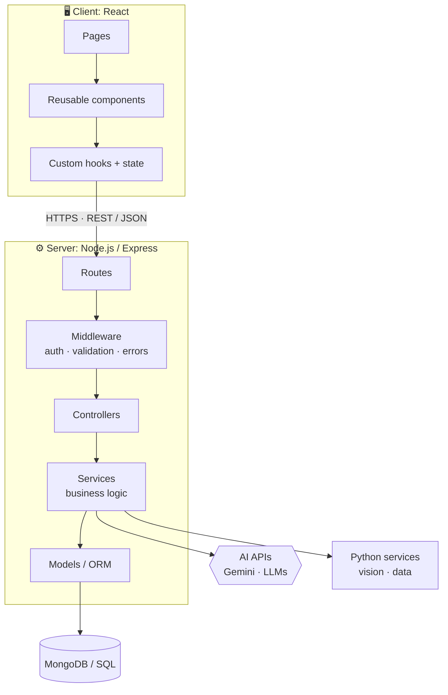
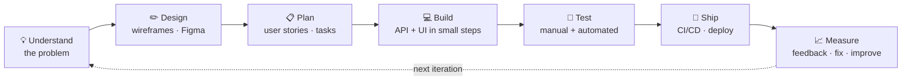

  

  
  

## 👋 About me

I'm a **full-stack developer**. I build web apps from the screen the user sees all the way down to the database.

- 🎨 **Frontend:** I build clean, responsive interfaces with **React**, **Tailwind** and **Bootstrap**.
- ⚙️ **Backend:** I write **REST APIs** with **Node.js** and **Express**, and store data in **MongoDB**.
- 🐍 **Python:** I use Python for logic, automation and computer vision with **OpenCV** and **MediaPipe**.
- 🤖 **AI:** I connect apps to AI models, such as **Google Gemini**, to make them smarter.
- 🏛️ **Architecture:** I think in clean layers (UI → API → services → data), REST design and role-based access.
- 🌱 **Right now:** I'm learning Next.js, TypeScript and AI agents, and making my projects production-ready with live demos, tests and clear docs.

> **What I bring to a team:** I can take a feature from idea to working product on my own: the UI, the API, the database and the AI part. I write code that other people can read.

## 🚀 Featured projects

<table>
<tr>
<td width="50%" valign="top">

### 🤖 [AI Resume Analyser](https://github.com/shivanjali24-03/AI-Resume-Analyser)
Upload a resume (PDF) and paste a job description. The app gives you an **ATS match score**, the skills you **have**, the skills you're **missing**, and clear tips to improve.

`React 19` `Vite` `Tailwind` `Node.js` `Express` `Gemini AI` `Multer` `PDF parsing`

</td>
<td width="50%" valign="top">

### 🧠 [Mind Mapper](https://github.com/shivanjali24-03/Mind-Mapper)
A mind-mapping app for organising ideas. A React frontend talks to an Express REST API that saves and loads mind maps from **MongoDB**.

`React` `Node.js` `Express` `MongoDB` `Mongoose` `REST API`

</td>
</tr>
<tr>
<td width="50%" valign="top">

### 🎫 [Ticketing Admin Dashboard](https://github.com/shivanjali24-03/Ticketing-)
An admin panel with a dashboard, user list, **role management**, account forms, profile and settings pages, all connected with client-side routing.

`React 19` `React Router` `Bootstrap` `Component design`

</td>
<td width="50%" valign="top">

### ✋ [Hand-Gesture Game (Python)](https://github.com/shivanjali24-03/python_projects)
A game you play with **your hand in front of the webcam**. No keyboard and no mouse. It tracks your hand in real time to catch falling objects. It's part of a day-by-day Python practice series.

`Python` `OpenCV` `MediaPipe` `Computer vision`

</td>
</tr>
</table>

## 🛠️ Tech stack

> ✅ **Built with**: used in my public projects &nbsp;·&nbsp; 🟣 **Comfortable with**: used in practice and learning projects &nbsp;·&nbsp; 🔭 **Exploring now**: currently learning

### ⚛️ React ecosystem

| | |
|:--|:--|
| ✅ **Built with** | React 19 (hooks, components) · Vite · React Router 7 · Tailwind CSS 4 · Bootstrap 5 · Axios · Lucide icons |
| 🟣 **Comfortable with** | Next.js (App Router) · TypeScript · Redux Toolkit · Zustand · TanStack Query · React Hook Form + Zod · shadcn/ui · Framer Motion |
| 🔭 **Exploring now** | React Server Components · Server Actions · React Compiler |

### 🟢 Node.js ecosystem

| | |
|:--|:--|
| ✅ **Built with** | Node.js · Express 5 · REST APIs · Mongoose · Multer (file uploads) · dotenv config |
| 🟣 **Comfortable with** | JWT auth · role-based access (RBAC) · Socket.IO (real-time) · Prisma ORM · input validation with Zod |
| 🔭 **Exploring now** | NestJS · tRPC · Bun · queues with BullMQ |

### 🐍 Python ecosystem

| | |
|:--|:--|
| ✅ **Built with** | Python 3 · OpenCV · MediaPipe · NumPy |
| 🟣 **Comfortable with** | FastAPI · Flask · Django · Pydantic · pandas |
| 🔭 **Exploring now** | LangChain · building AI agents |

### 🗄️ Data, 🤖 AI and ☁️ DevOps

| Area | Tools |
|:--|:--|
| **Databases** | ✅ MongoDB · 🟣 MySQL · PostgreSQL · Redis (caching) |
| **AI** | ✅ Google Gemini API, structured JSON output · 🟣 prompt engineering · OpenAI / Claude APIs · 🔭 RAG with vector search |
| **Testing** | 🟣 Jest · React Testing Library · Postman API testing · 🔭 Vitest · Playwright |
| **DevOps** | ✅ Git & GitHub · GitHub Actions (this profile updates itself daily) · 🟣 Docker · Vercel · Render |

## 🏛️ Architecture & design patterns I use

<table>
<tr>
<td width="50%" valign="top">

**Frontend patterns**
- **Component-based UI**: small, reusable pieces (`Sidebar`, `Header`, `UserNav`)
- **Pages + components** folder structure
- **Custom hooks** to keep logic out of the UI
- **Container / presentational** split
- **Client-side routing** for fast, app-like navigation
- **Mobile-first, responsive** design

</td>
<td width="50%" valign="top">

**Backend patterns**
- **MVC / layered architecture**: routes → controllers → services → models
- **RESTful API design** with proper status codes and clean JSON errors
- **Middleware** for auth, uploads, validation and error handling
- **Role-based access control** (admin, user, and so on)
- **Config in environment variables**, never hard-coded secrets
- **Monolith first**, split into services only when needed

</td>
</tr>
</table>

## 🔄 How I take a product from idea to launch

1. **Understand:** Who is the user, what's their problem, and what does success look like?
2. **Design:** Sketch the screens and the data model before writing code.
3. **Plan:** Break the work into small user stories and work in **Agile** sprints.
4. **Build:** Start with the API, then the UI. Make small commits with clear messages, and use branches and pull requests.
5. **Test:** Test every endpoint in Postman, add unit tests for the core logic, and check the UI on mobile.
6. **Ship:** Deploy early (Vercel / Render) and let GitHub Actions automate the routine steps.
7. **Improve:** Listen to feedback, fix what hurts most first, and repeat.

## 📊 My GitHub in graphs

<picture>
  <source media="(prefers-color-scheme: dark)" srcset="https://raw.githubusercontent.com/shivanjali24-03/shivanjali24-03/output/github-snake-dark.svg"/>
  <source media="(prefers-color-scheme: light)" srcset="https://raw.githubusercontent.com/shivanjali24-03/shivanjali24-03/output/github-snake.svg"/>
  
</picture>

<b>📈 More activity</b>

 

## 🤝 Let's work together

I'm open to **full-time full-stack developer roles** and **freelance projects**, such as web apps, dashboards, REST APIs and AI features for existing products.

<!-- Add your links here, then remove these comment markers:

-->

