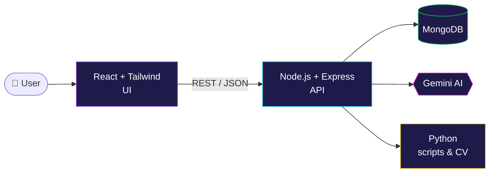

  

  
  

## 👋 About me

I'm a **full-stack developer**. I build web apps from the screen the user sees all the way down to the database.

- 🎨 **Frontend:** I build clean, responsive interfaces with **React**, **Tailwind** and **Bootstrap**.
- ⚙️ **Backend:** I write **REST APIs** with **Node.js** and **Express**, and store data in **MongoDB**.
- 🐍 **Python:** I use Python for logic, automation and computer vision with **OpenCV** and **MediaPipe**.
- 🤖 **AI:** I connect apps to AI models, such as **Google Gemini**, to make them smarter.
- 🌱 **Right now:** I'm making my projects production-ready with live demos, tests and clear docs.

> **What I bring to a team:** I can take a feature from idea to working product on my own: the UI, the API, the database and the AI part. I write code that other people can read.

## 🚀 Featured projects

<table>
<tr>
<td width="50%" valign="top">

### 🤖 [AI Resume Analyser](https://github.com/shivanjali24-03/AI-Resume-Analyser)
Upload a resume (PDF) and paste a job description. The app gives you an **ATS match score**, the skills you **have**, the skills you're **missing**, and clear tips to improve.

`React 19` `Vite` `Tailwind` `Node.js` `Express` `Gemini AI` `Multer` `PDF parsing`

</td>
<td width="50%" valign="top">

### 🧠 [Mind Mapper](https://github.com/shivanjali24-03/Mind-Mapper)
A mind-mapping app for organising ideas. A React frontend talks to an Express REST API that saves and loads mind maps from **MongoDB**.

`React` `Node.js` `Express` `MongoDB` `Mongoose` `REST API`

</td>
</tr>
<tr>
<td width="50%" valign="top">

### 🎫 [Ticketing Admin Dashboard](https://github.com/shivanjali24-03/Ticketing-)
An admin panel with a dashboard, user list, **role management**, account forms, profile and settings pages, all connected with client-side routing.

`React 19` `React Router` `Bootstrap` `Component design`

</td>
<td width="50%" valign="top">

### ✋ [Hand-Gesture Game (Python)](https://github.com/shivanjali24-03/python_projects)
A game you play with **your hand in front of the webcam**. No keyboard and no mouse. It tracks your hand in real time to catch falling objects. It's part of a day-by-day Python practice series.

`Python` `OpenCV` `MediaPipe` `Computer vision`

</td>
</tr>
</table>

## 🛠️ Tech stack

| Area | Tools |
|:--|:--|
| **Frontend** |  |
| **Backend** |  |
| **Database** |  |
| **AI & Vision** |    |
| **Tools** |  |

## 🧩 How I build a full-stack app

## 📊 My GitHub in graphs

<picture>
  <source media="(prefers-color-scheme: dark)" srcset="https://raw.githubusercontent.com/shivanjali24-03/shivanjali24-03/output/github-snake-dark.svg"/>
  <source media="(prefers-color-scheme: light)" srcset="https://raw.githubusercontent.com/shivanjali24-03/shivanjali24-03/output/github-snake.svg"/>
  
</picture>

<b>📈 More activity</b>

 

## 🤝 Let's work together

I'm open to **full-time full-stack developer roles** and **freelance projects**, such as web apps, dashboards, REST APIs and AI features for existing products.

<!-- Add your links here, then remove these comment markers:

-->

