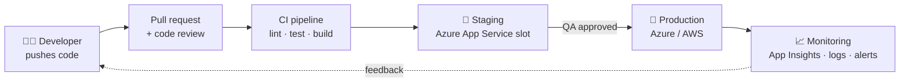
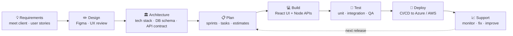
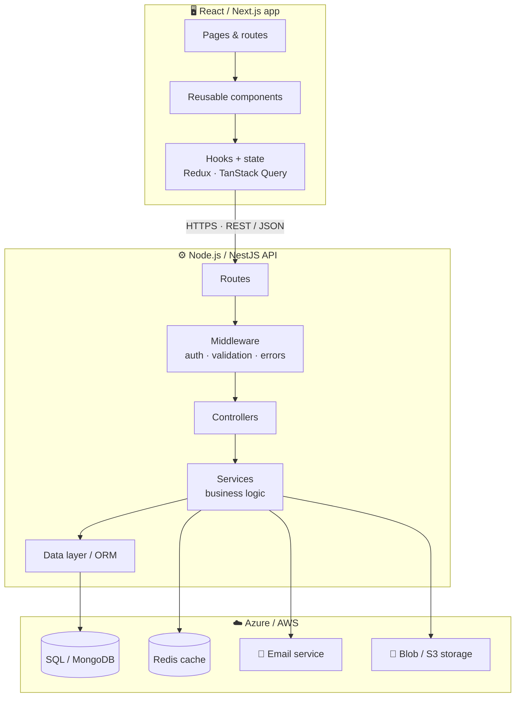

  
  
  

  
  

## 👋 About me

I'm a **senior React and full-stack developer** with **7+ years** of building web products, from an empty repo to a live, scaled product, and leading the teams that build them.

- ⚛️ **React first:** I build fast, polished, accessible interfaces with **React**, **Next.js**, **TypeScript**, **Redux Toolkit** and **Tailwind**.
- ⚙️ **Full-stack:** I design the APIs and databases behind the UI with **Node.js**, **NestJS**, **Express** and **Flask**, on **PostgreSQL**, **SQL Server** and **MongoDB**.
- ☁️ **Cloud and delivery:** I deploy and run apps on **Azure** (App Service, Functions, email services, Key Vault) and **AWS**, with automated **CI/CD** pipelines.
- 👥 **Leadership:** I lead teams, plan sprints, review code, mentor developers, and work directly with clients, product owners and designers.
- 🤖 **AI where it helps:** I use AI tools and APIs to build smarter features and to work faster, not for the sake of it.

> **What I bring to a team:** I can take a product **from scratch to production**: the UI, the API, the database, the cloud setup and the release pipeline. I can also lead the people building it.

## 🛠️ Tech stack

| Area | Core: what I use every day | Also worked with |
|:--|:--|:--|
| ⚛️ **Frontend (React)** | **React 18/19** · **Next.js** (App Router, SSR/SSG) · **TypeScript** · **Redux Toolkit** · **TanStack Query** | Zustand · Context API · React Router · React Hook Form + Zod · Tailwind CSS · Material UI · shadcn/ui · Bootstrap · Sass · Framer Motion · Storybook · Vite / Webpack |
| ⚙️ **Backend** | **Node.js** · **NestJS** · **Express** · REST APIs | Flask (Python) · GraphQL · Socket.IO · Prisma · TypeORM · Mongoose · JWT / OAuth 2.0 · Swagger / OpenAPI |
| 🗄️ **Databases** | **PostgreSQL** · **SQL Server** · **MongoDB** | MySQL · Redis (caching) · Azure SQL |
| 🧪 **Quality** | **Jest** · **React Testing Library** · code reviews | Cypress / Playwright · Postman · ESLint / Prettier · SonarQube |
| 🧰 **Tools & process** | **Git** · **Jira** · **Agile / Scrum** | Azure Boards · Figma · Confluence · VS Code |

## ☁️ Cloud, DevOps and CI/CD

| Platform | Services I've used |
|:--|:--|
| **Microsoft Azure** | **Azure App Service** (Web Apps for React and Node.js) · **Static Web Apps** · **Azure Functions** · **Azure email setup** (Communication Services Email, SMTP, SendGrid) · Blob Storage · **Azure SQL** · Key Vault (secrets) · Application Insights (monitoring) · **Microsoft Entra ID** (Azure AD login / SSO) · custom domains and SSL |
| **AWS** | EC2 · S3 · CloudFront (CDN) · Lambda · RDS · SES (email) · IAM · Route 53 |
| **CI/CD** | **Azure DevOps Pipelines** · **GitHub Actions**: build, test and deploy on every merge · separate **dev / staging / production** environments · environment variables and secrets management · deployment slots for zero-downtime releases |

## 👥 Leadership & teamwork

<table>
<tr>
<td width="50%" valign="top">

**Leading the team**
- Lead and mentor **frontend and full-stack developers**
- Run **sprint planning**, estimation and stand-ups
- Set **coding standards**, folder structure and review rules
- Do thorough **code reviews** that teach, not just approve
- Help **hire**: technical interviews and onboarding new joiners

</td>
<td width="50%" valign="top">

**Working with the business**
- Turn client and business needs into **clear user stories**
- Work closely with **product owners, designers and QA**
- Give **honest estimates** and flag risks early
- Present demos and progress to **stakeholders**
- Make **technical decisions**, and explain them in plain English

</td>
</tr>
</table>

## 🏗️ Full product development: from scratch to the end

| Stage | What I do |
|:--|:--|
| **1. Requirements** | Meet the client, understand the real problem, and write user stories with clear acceptance criteria |
| **2. Design** | Work with designers in Figma, and check the flows for usability and edge cases |
| **3. Architecture** | Choose the tech stack, design the database schema and API contracts, and plan auth and roles |
| **4. Setup** | Create the repo, folder structure, linting, environments and the CI/CD pipeline on day one |
| **5. Build** | Reusable React components, state management, secure REST APIs, and email and file features |
| **6. Test** | Unit and integration tests, code reviews, QA cycles and performance checks |
| **7. Deploy** | Automated releases to Azure App Service / AWS, with custom domains, SSL and secrets in Key Vault |
| **8. Support & grow** | Monitoring with Application Insights, bug fixes, new features, and scaling as users grow |

## 🏛️ Architecture & design patterns

<table>
<tr>
<td width="50%" valign="top">

**React / frontend**
- **Component-driven** UI and reusable **design systems**
- **Feature-based folder structure** for large apps
- **Custom hooks** to keep logic clean and testable
- **Server state vs client state** (TanStack Query + Redux / Zustand)
- **SSR / SSG** with Next.js for speed and SEO
- **Performance**: code splitting, lazy loading, memoization, Core Web Vitals
- **Accessibility** (WCAG) and responsive, mobile-first design

</td>
<td width="50%" valign="top">

**Backend & system**
- **Layered architecture**: controllers → services → data layer
- **Modular monolith first**, microservices when scale needs it
- **RESTful API design**, versioning and Swagger docs
- **Auth**: JWT, OAuth 2.0, SSO with Entra ID, role-based access
- **Background jobs** and transactional **email** flows
- **Caching** with Redis, plus rate limiting
- **SOLID** principles, dependency injection (NestJS), 12-factor config

</td>
</tr>
</table>

## 🚀 Featured projects

<table>
<tr>
<td width="50%" valign="top">

### 📄 [Resume Analyser](https://github.com/shivanjali24-03/AI-Resume-Analyser)
A React app where you upload a resume (PDF) and paste a job description. It shows a **match score**, the skills you **have**, the skills you're **missing**, and tips to improve. The text analysis is done by an AI API.

`React 19` `Vite` `Tailwind` `Node.js` `Express` `File upload` `PDF parsing`

</td>
<td width="50%" valign="top">

### 🧠 [Mind Mapper](https://github.com/shivanjali24-03/Mind-Mapper)
A mind-mapping app for organising ideas. A React frontend talks to an Express REST API that saves and loads mind maps from **MongoDB**.

`React` `Node.js` `Express` `MongoDB` `Mongoose` `REST API`

</td>
</tr>
<tr>
<td width="50%" valign="top">

### 🎫 [Ticketing Admin Dashboard](https://github.com/shivanjali24-03/Ticketing-)
An admin panel with a dashboard, user list, **role management**, account forms, profile and settings pages, all connected with client-side routing.

`React 19` `React Router` `Bootstrap` `Component design`

</td>
<td width="50%" valign="top">

### ✋ [Hand-Gesture Game (Python)](https://github.com/shivanjali24-03/python_projects)
A game you play with **your hand in front of the webcam**. No keyboard and no mouse. It tracks your hand in real time to catch falling objects.

`Python` `OpenCV` `MediaPipe` `Computer vision`

</td>
</tr>
</table>

## 📊 My GitHub in graphs

<picture>
  <source media="(prefers-color-scheme: dark)" srcset="https://raw.githubusercontent.com/shivanjali24-03/shivanjali24-03/output/github-snake-dark.svg"/>
  <source media="(prefers-color-scheme: light)" srcset="https://raw.githubusercontent.com/shivanjali24-03/shivanjali24-03/output/github-snake.svg"/>
  
</picture>

<b>📈 More activity</b>

 

## 🤝 Let's work together

I'm open to **Senior React Developer**, **Senior Full-Stack Developer** and **Frontend / Tech Lead** roles. I'm also available for **freelance projects**, from a new product built from scratch to taking over and improving an existing React app.

<!-- Add your links here, then remove these comment markers:

-->

