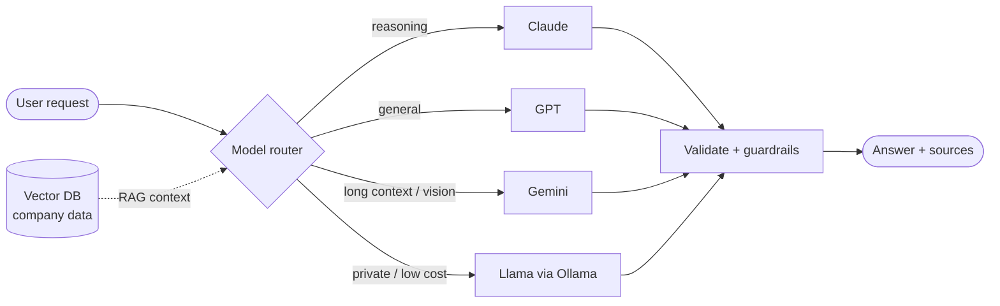
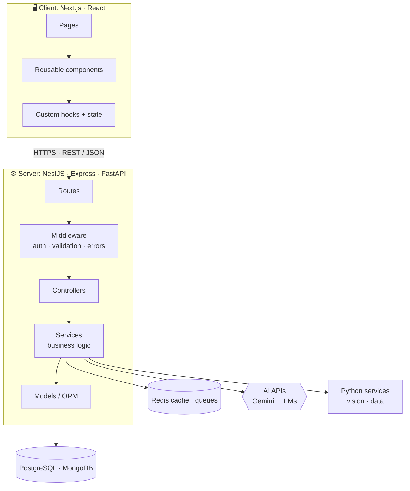
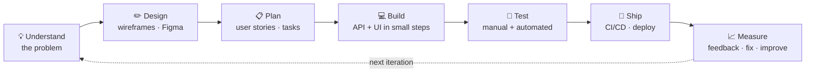

  
  

  
  

## 👋 About me

I'm a **senior full-stack and AI engineer** with **7+ years** of building web products from the first idea to production, and then scaling them.

- 🎨 **Frontend:** I build fast, polished interfaces with **Next.js**, **React 19**, **TypeScript**, **Tailwind** and **Framer Motion**, with design systems, accessibility and Core Web Vitals in mind.
- ⚙️ **Backend:** I design APIs and services with **NestJS**, **Express**, **Flask** and **FastAPI**, both REST and GraphQL, on **PostgreSQL**, **MongoDB** and **Redis**.
- 🤖 **AI:** I build **multi-LLM** products with **OpenAI, Claude, Gemini and open-source Llama models**. That covers RAG over company data, AI agents with tool calling, prompt design, model routing, and evaluating output quality.
- 🏛️ **Architecture:** clean, layered and modular systems, from microservices and event-driven design to caching, auth/RBAC, and cloud deployment with Docker and CI/CD.
- 🧭 **Product:** I think like a product owner. I care about the user problem, the metric we're moving, and shipping in small, safe steps.

> **What I bring to a team:** I own features end to end (UI, API, data and AI), make sound architecture calls, mentor other developers, and work directly with product and design to ship things users love.

## 🚀 Featured projects

<table>
<tr>
<td width="50%" valign="top">

### 🤖 [AI Resume Analyser](https://github.com/shivanjali24-03/AI-Resume-Analyser)
Upload a resume (PDF) and paste a job description. The app gives you an **ATS match score**, the skills you **have**, the skills you're **missing**, and clear tips to improve.

`React 19` `Vite` `Tailwind` `Node.js` `Express` `Gemini AI` `Multer` `PDF parsing`

</td>
<td width="50%" valign="top">

### 🧠 [Mind Mapper](https://github.com/shivanjali24-03/Mind-Mapper)
A mind-mapping app for organising ideas. A React frontend talks to an Express REST API that saves and loads mind maps from **MongoDB**.

`React` `Node.js` `Express` `MongoDB` `Mongoose` `REST API`

</td>
</tr>
<tr>
<td width="50%" valign="top">

### 🎫 [Ticketing Admin Dashboard](https://github.com/shivanjali24-03/Ticketing-)
An admin panel with a dashboard, user list, **role management**, account forms, profile and settings pages, all connected with client-side routing.

`React 19` `React Router` `Bootstrap` `Component design`

</td>
<td width="50%" valign="top">

### ✋ [Hand-Gesture Game (Python)](https://github.com/shivanjali24-03/python_projects)
A game you play with **your hand in front of the webcam**. No keyboard and no mouse. It tracks your hand in real time to catch falling objects. It's part of a day-by-day Python practice series.

`Python` `OpenCV` `MediaPipe` `Computer vision`

</td>
</tr>
</table>

## 🛠️ Tech stack

| Area | Core: what I reach for first | Also shipped with |
|:--|:--|:--|
| ⚛️ **Frontend** | **Next.js** (App Router, Server Components, Server Actions) · **React 19** · **TypeScript** · **Tailwind CSS** · **Vite** | Redux Toolkit · Zustand · TanStack Query · React Hook Form + Zod · shadcn/ui · Framer Motion · Storybook |
| ⚙️ **Node.js backend** | **NestJS** (modules, DI, guards) · **Express** · REST · **GraphQL** | Prisma · TypeORM · Mongoose · Socket.IO · BullMQ queues · tRPC · JWT / OAuth 2.0 |
| 🐍 **Python backend** | **FastAPI** · **Flask** · Pydantic | Django + DRF · Celery · pandas · NumPy · OpenCV · MediaPipe |
| 🗄️ **Data** | **PostgreSQL** · **MongoDB** · **Redis** | MySQL · pgvector · Pinecone · Elasticsearch |
| ☁️ **Cloud & DevOps** | **Docker** · **GitHub Actions CI/CD** · **AWS** (EC2, S3, Lambda) | Vercel · Render · Nginx · monitoring and logging |
| 🧪 **Quality** | **Jest** · **Vitest** · **Playwright** · React Testing Library | Postman · code reviews · ESLint / Prettier · Dependabot |

### 🤖 AI & LLM engineering

I don't lock products to one model. I pick the right model for each job, and swap or combine them as cost, speed and quality require.

| What I build | How |
|:--|:--|
| **RAG (chat with your data)** | Chunking, embeddings and vector search (pgvector / Pinecone), with answers that cite their sources |
| **AI agents** | Tool and function calling, multi-step workflows, MCP integrations, human-in-the-loop checks |
| **Multi-LLM routing** | Send each task to the best model for its cost and speed, with fallbacks if a provider fails |
| **Structured output** | JSON-schema responses validated with Zod or Pydantic, so the AI's output can safely drive the app |
| **Production readiness** | Streaming responses, caching, rate limits, prompt versioning, evals, guardrails and cost tracking |

## 🏛️ Architecture & design patterns I use

<table>
<tr>
<td width="50%" valign="top">

**Frontend patterns**
- **Server + client components** (Next.js) for speed and SEO
- **Design systems** with reusable, accessible components
- **Custom hooks** and **feature-based folders**
- **Server state vs client state** (TanStack Query + Zustand)
- **Micro-frontends** for large teams, when needed
- **Performance**: code splitting, lazy loading, Core Web Vitals

</td>
<td width="50%" valign="top">

**Backend patterns**
- **Layered / Clean architecture**: controllers → services → repositories
- **Modular monolith → microservices** when scale demands it
- **Event-driven** design with queues and background jobs
- **REST + GraphQL API design**, versioning and OpenAPI docs
- **Auth**: JWT, OAuth 2.0 / SSO, role-based access (RBAC)
- **Caching** with Redis, plus rate limiting and idempotency
- **SOLID**, dependency injection (NestJS), 12-factor config

</td>
</tr>
</table>

## 🔄 How I take a product from idea to launch

1. **Understand:** Who is the user, what's their problem, and what does success look like?
2. **Design:** Sketch the screens and the data model before writing code.
3. **Plan:** Break the work into small user stories and work in **Agile** sprints.
4. **Build:** Start with the API, then the UI. Make small commits with clear messages, and use branches and pull requests.
5. **Test:** Test every endpoint in Postman, add unit tests for the core logic, and check the UI on mobile.
6. **Ship:** Deploy early (Vercel / Render) and let GitHub Actions automate the routine steps.
7. **Improve:** Listen to feedback, fix what hurts most first, and repeat.

## 📊 My GitHub in graphs

<picture>
  <source media="(prefers-color-scheme: dark)" srcset="https://raw.githubusercontent.com/shivanjali24-03/shivanjali24-03/output/github-snake-dark.svg"/>
  <source media="(prefers-color-scheme: light)" srcset="https://raw.githubusercontent.com/shivanjali24-03/shivanjali24-03/output/github-snake.svg"/>
  
</picture>

<b>📈 More activity</b>

 

## 🤝 Let's work together

I'm open to **senior full-stack / AI engineer roles** and **freelance projects**: SaaS products, AI features (chatbots, RAG, agents) for existing apps, dashboards and scalable APIs.

<!-- Add your links here, then remove these comment markers:

-->

